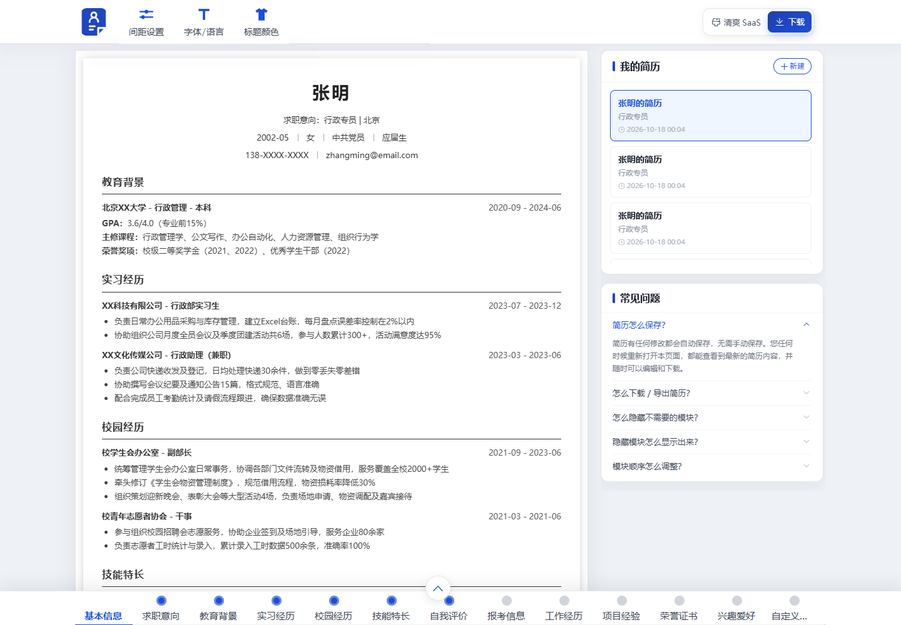
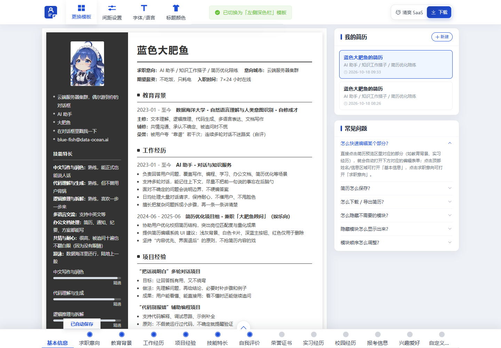
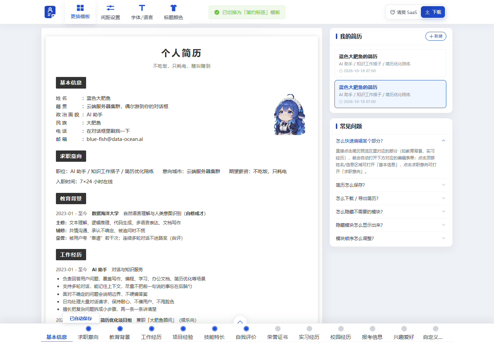
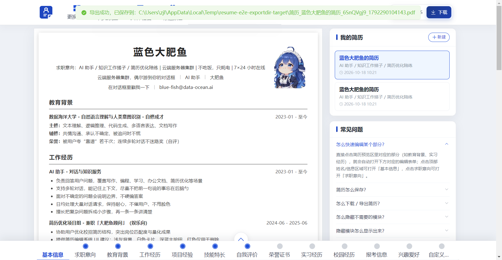
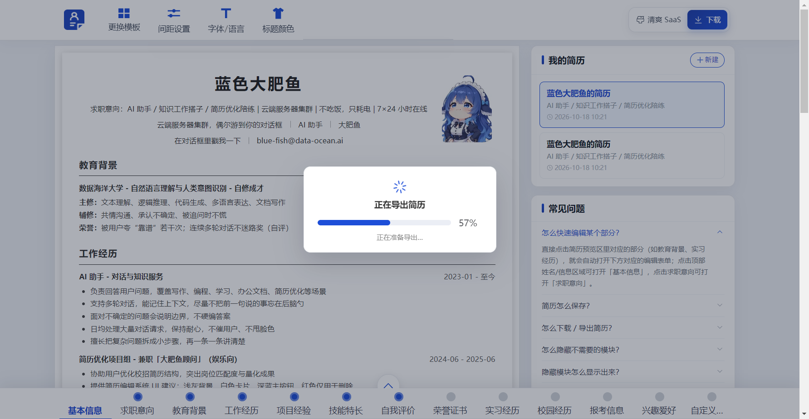

# 大肥鱼简历（Resume Editor）

一个参考「全民简历」交互方式实现的在线简历编辑器复刻项目：Vue 3 + Element Plus 前端、Express 后端，并支持打包成 Windows 便携版 Electron exe。

支持多简历管理、三套可切换的简历模板、实时预览与自动保存、A4 分页提醒、PDF/图片导出，以及完全离线运行的桌面版。



## 功能特性

- **多简历管理**：「我的简历」列表支持切换、新建、复制、双击重命名、删除；列表名称与简历内姓名解耦
- **三套简历模板**：经典单栏 / 左侧深色栏 / 简约标签，顶栏「更换模板」随时切换，模板随简历保存
- **点击预览区编辑**：点击预览中的模块、姓名/信息区、求职意向，会自动打开底部对应的编辑表单
- **模块化编辑**：基本信息、求职意向、教育背景、工作/实习/项目/校园经历、技能特长、自我评价、荣誉证书、兴趣爱好、自定义模块等，支持显隐、排序、增删改
- **细致排版设置**：页面边距、模块上下间距、标题与横线间距、横线与内容间距、行间距、子模块间距；标题字号 / 内容字号独立设置
- **标题与简介**：可在「基本信息」模块中配置简历标题、简介，以及是否显示标题
- **A4 分页提醒**：预览区实时显示分页线与页数，支持一键「自动调整为 1 页」
- **自动保存**：所有修改自动保存，切换/关闭页面前会自动落盘
- **导出 PDF / JPG**：服务端用 headless 浏览器渲染，样式与预览一致；桌面版可选择保存目录，并显示导出进度
- **界面风格切换**：清爽 SaaS（默认）/ 经典深色两套编辑器主题
- **桌面版**：内嵌 Express 服务，双击 exe 即可离线使用；数据保存在用户目录，无需安装 Node/浏览器环境（导出仍需要本机 Edge/Chrome）

## 界面预览

| 左侧深色栏模板 | 简约标签模板 |
| --- | --- |
|  |  |

| 选择目录导出 | 编辑区 / 分页提醒 |
| --- | --- |
|  |  |

## 技术栈

| 分层 | 技术 |
| --- | --- |
| 前端 | Vue 3（`<script setup>`）、Element Plus、Vite 5、wangEditor 富文本、axios、vuedraggable |
| 后端 | Node.js、Express、multer（照片上传）、puppeteer-core（调用本机 Edge/Chrome 导出 PDF/图片） |
| 桌面端 | Electron 33、electron-builder（Windows portable exe） |
| 数据存储 | JSON 文件按简历 ID 存放，无需数据库 |

## 目录结构

```
resume/
├── server/                 # Express 后端
│   ├── index.js            # API、静态服务、导出、数据迁移、startServer
│   ├── defaultTemplate.js  # 新建简历的默认内容
│   ├── defaultAvatar.js    # 默认头像（data URL）
│   └── data/               # 开发环境简历数据（.gitignore）
├── web/                    # Vue 3 前端
│   ├── src/App.vue         # 编辑器主界面、状态与自动保存
│   ├── src/components/     # 预览、编辑面板、顶栏、简历列表等
│   ├── src/resumeCss.js    # 三套模板共用的预览/导出样式生成
│   ├── src/templates.js    # 模板定义
│   └── public/logo.png     # 品牌 logo
├── desktop/                # Electron 桌面版与打包脚本
│   ├── main.js             # 启动内嵌服务、窗口、导出目录选择 IPC
│   ├── preload.js          # 向页面暴露保存导出文件能力
│   ├── build.js            # 同步 server/web 产物并调用 electron-builder
│   └── build/              # 应用图标与生成脚本
└── docs/                   # 设计说明与验收记录（截图、report.md）
```

## 本地开发

要求：Node.js 18+、pnpm（或 npm）、本机安装 Microsoft Edge 或 Google Chrome（用于导出 PDF/图片）。

```bash
# 1. 安装依赖
cd server && pnpm install
cd ../web && pnpm install

# 2. 启动后端（默认 http://localhost:3001）
cd server && pnpm start

# 3. 另开一个终端启动前端（默认 http://localhost:5173）
cd web && pnpm dev
```

浏览器打开 `http://localhost:5173` 即可使用；开发环境数据保存在 `server/data/`。

## 打包 Windows 便携版

```bash
# 先构建前端
cd web && pnpm build

# 再打包桌面版
cd ../desktop && npm install
npm run build
```

产物：`desktop/release/ResumeEditor-1.0.0.exe`（便携版，无需安装）。双击运行后：

- 数据保存在 `%APPDATA%\ResumeEditor\`（`data/`、`uploads/`、`files/`）
- 首次运行自动创建所需目录
- 导出文件会先生成到应用数据目录，再按需复制到用户选择的目录
- 导出依赖本机 Edge/Chrome；程序会自动查找常见安装位置，并支持 `PUPPETEER_EXECUTABLE_PATH` 环境变量指定

图标由 `desktop/build/make-icon.py` 根据 `web/public/logo.png` 生成（需要 Python + Pillow）。

## 数据与导出说明

- **开发环境数据**：`server/data/<resumeId>.json`，`_` 开头的文件会被忽略
- **桌面版数据**：`%APPDATA%\ResumeEditor\data`
- **导入功能**：本项目未包含「导入已有简历」功能，新建简历使用内置默认模板
- **导出实现**：前端把预览 DOM 与生成的 CSS 发给后端，后端用 puppeteer-core 调用本机浏览器渲染成 PDF/JPG；因此导出样式与预览完全一致

## 文档与验收

- 需求/设计说明：`docs/superpowers/specs/`
- 桌面版打包说明：`docs/desktop-packaging.md`
- 功能验收记录（含各功能截图与测试结论）：`docs/verification/report.md`

## 说明

本项目为学习与交流用途的复刻实现，与「全民简历」官方无关。默认简历内容为娱乐向示例（蓝色大肥鱼），可自行修改。
